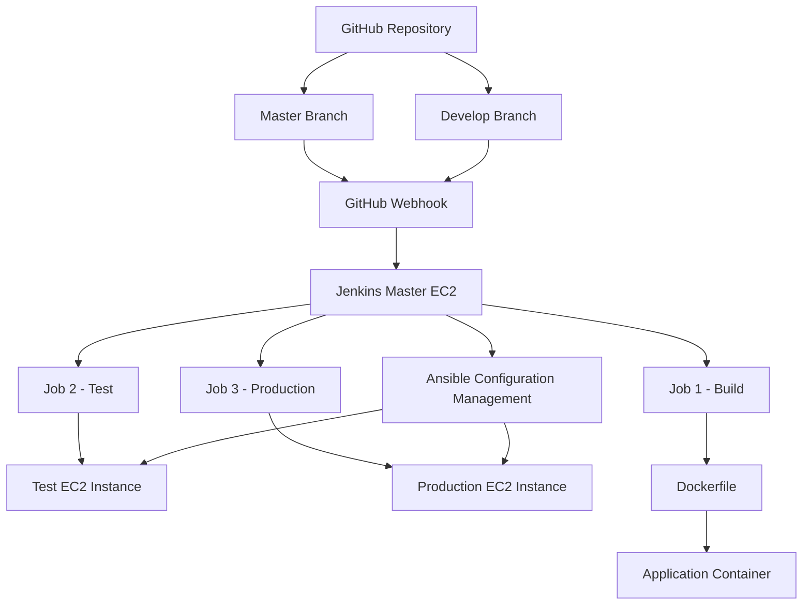

# AWS DevOps Lifecycle Implementation
## Capstone Project – Abode Software

## 1. Project Overview

This project demonstrates the implementation of an end-to-end DevOps lifecycle for Abode Software using AWS and DevOps tools.

The objective is to automate application building, testing, containerization and deployment.

## 2. Project Objectives

- Automate software installation using Ansible.
- Implement GitHub branch-based workflows.
- Configure Jenkins CI/CD pipelines.
- Containerize the application using Docker.
- Automate testing and production deployment.

## 3. Tools and Technologies

| Technology | Purpose |
|---|---|
| AWS EC2 | Infrastructure hosting |
| Ubuntu | Operating system |
| GitHub | Version control |
| Ansible | Configuration management |
| Jenkins | CI/CD automation |
| Docker | Containerization |

## 4. Infrastructure Architecture

Three AWS EC2 instances were configured:

- Master Server – Jenkins and Ansible.
- Test Server – Application testing.
- Production Server – Production deployment.

## 5. Implementation Steps

### Step 1: AWS EC2 Setup
Created three Ubuntu EC2 instances for master, test and production environments.

### Step 2: Ansible Configuration
Installed Ansible and configured SSH connectivity between the servers.

### Step 3: Jenkins Installation
Installed Jenkins and configured the dashboard and build agents.

### Step 4: GitHub Integration
Created master and develop branches and configured GitHub webhooks.

### Step 5: Docker Implementation
Created a Dockerfile using the hshar/webapp base image.

### Step 6: Jenkins CI/CD Pipeline
Configured three Jenkins jobs:

- Job 1 – Build
- Job 2 – Test
- Job 3 – Production

## 6. CI/CD Workflow

- Develop branch: Build and testing.
- Master branch: Build, testing and production deployment.

## 7. Final Results

- Configured three AWS EC2 instances.
- Established server connectivity using Ansible.
- Integrated GitHub with Jenkins using webhooks.
- Configured Docker-based application builds.
- Configured three Jenkins jobs.
- Implemented a structured CI/CD workflow.

## 8. Key Learning Outcomes

- AWS EC2 management
- Linux administration
- Ansible automation
- Git and GitHub
- Jenkins pipelines
- Docker containerization
- CI/CD implementation

## 9. Conclusion

Successfully implemented a structured DevOps lifecycle integrating AWS, GitHub, Ansible, Jenkins and Docker to automate application build, testing and deployment workflows.
## 10. Project Architecture Diagram

The following diagram represents the AWS DevOps CI/CD architecture implemented for Abode Software.

